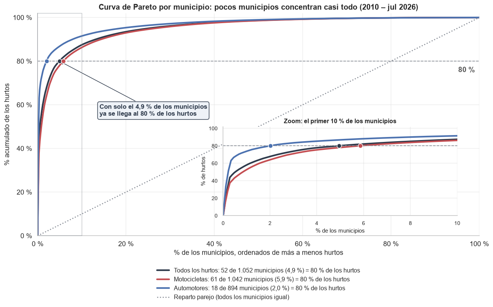
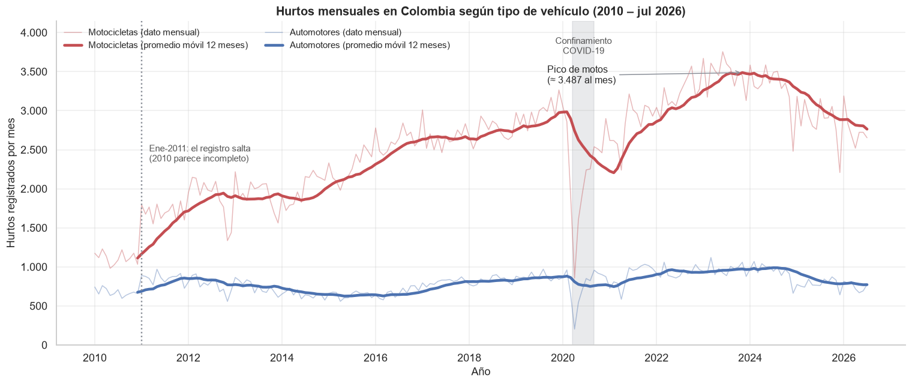
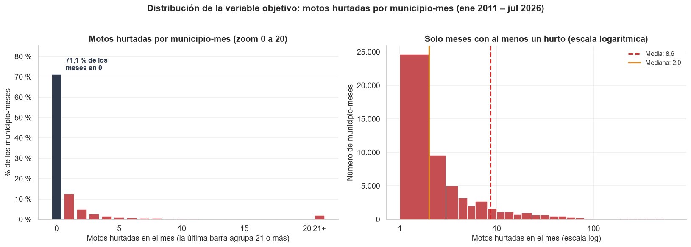
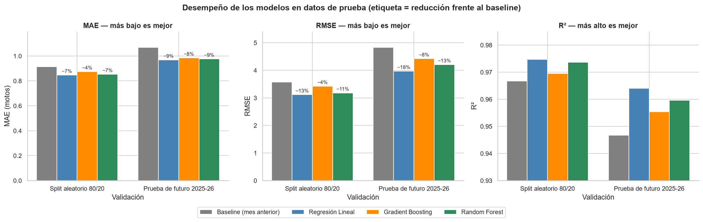
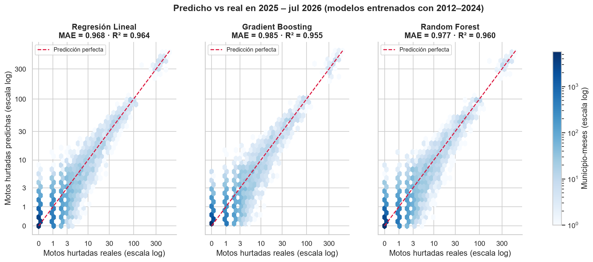
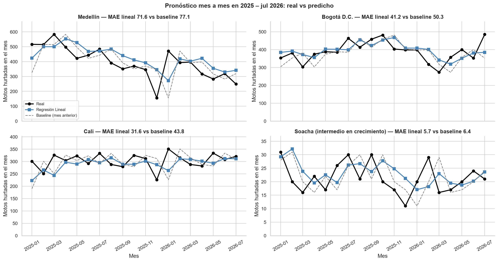
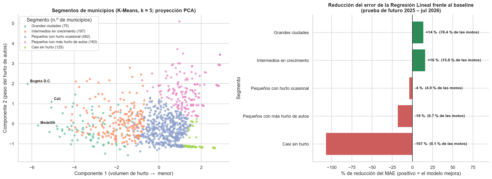

# Informe final — Proyecto 2 y 3: Análisis, limpieza y modelado del hurto de motocicletas en Colombia

**Curso:** Introducción a la Ciencia de los Datos · **Profesor:** Héctor Fabio Ocampo Arbeláez

**Integrantes:**
- Diego Andrés Bolaños Isiquita (202379918)
- Diego Alejandro Gómez Puentes (202411026)
- David Stiven Mujanajinsoy Jajoy (202376834)

**Fecha:** octubre de 2026

---

## 1. Contexto del dataset y pregunta de negocio

### 1.1 El dataset

Trabajamos con el **Reporte de Hurto por Modalidades de la Policía Nacional** (`Reporte_Hurto_por_Modalidades_Policía_Nacional_20260916.csv`), el mismo dataset del Proyecto 1. Contiene **656.635 registros** de hurtos de vehículos ocurridos entre **enero de 2010 y julio de 2026**, con 9 columnas:

| Grupo | Columnas |
|---|---|
| Lugar | `DEPARTAMENTO`, `MUNICIPIO`, `CODIGO DANE` |
| Tiempo | `FECHA HECHO` |
| Descripción del hecho | `TIPO DE HURTO` (motocicletas o automotores), `ARMAS MEDIOS`, `GENERO`, `GRUPO ETARIO` |
| Conteo | `CANTIDAD` (vale 1 en todas las filas) |

Cada fila es un vehículo hurtado. Las motocicletas son el **76 %** de los casos (497.736) y los automotores el 24 % (158.899).

### 1.2 Pregunta de negocio

> **¿Es posible predecir la cantidad de hurtos de motocicletas que se presentarán en un municipio durante el siguiente mes, utilizando el comportamiento histórico de los hurtos y las variables disponibles en el dataset?**

Una predicción así permitiría a la Policía y a las alcaldías **anticipar dónde reforzar la vigilancia** el mes siguiente, en lugar de reaccionar cuando el problema ya ocurrió.

Como el objetivo es un número (cuántas motos se hurtan), es un problema de **regresión**. La unidad de análisis es el **municipio-mes**: una fila por municipio y mes con el número de motos hurtadas.

---

## 2. Resumen del análisis exploratorio (Fase A)

El archivo no trae variables numéricas útiles: `CANTIDAD` vale siempre 1 y `CODIGO DANE` es una etiqueta. Por eso construimos la tabla de **motos hurtadas por municipio-mes** (194.854 filas: 1.042 municipios × 187 meses, de enero de 2011 a julio de 2026), completando con 0 los meses sin hurtos. En el diagnóstico encontramos además que **58 nombres de municipio se repiten en distintos departamentos**, así que la llave del municipio es *departamento + municipio*.

### Hallazgo 1. El hurto está extremadamente concentrado

*Figura 1. Curva de Pareto: porcentaje acumulado de hurtos según el porcentaje de municipios (2010 – jul 2026).*

El problema es **más concentrado que la regla 80/20**: solo **52 de 1.052 municipios (4,9 %)** reúnen el 80 % de los hurtos, y **Bogotá, Medellín y Cali suman el 44 %**. En automotores la concentración es aún mayor (18 municipios hacen el 80 %), mientras que en motos está algo más repartida (61 municipios).

### Hallazgo 2. Las motos son el centro del problema y su tendencia ya cambió

*Figura 2. Hurtos mensuales por tipo de vehículo; las líneas gruesas son el promedio móvil de 12 meses.*

El hurto de motos se **duplicó entre 2011 y 2023** (de 20.448 a 41.705 al año), mientras el de automotores casi no cambió. Desde 2023 baja (−17 % en 2025). El registro salta +59 % entre diciembre de 2010 y enero de 2011, señal de que **2010 está subregistrado**; por eso la serie de modelado empieza en 2011.

### Hallazgo 3. La variable objetivo tiene muchos ceros, pero es predecible

*Figura 3. Motos hurtadas por municipio-mes: frecuencia de 0 a 20 (izquierda) y meses con al menos un hurto en escala logarítmica (derecha).*

En el **71 % de los municipio-meses no se hurtó ninguna moto**, pero Medellín llega a 658 en un mes: la varianza es 150 veces la media. Aun así, el historial del municipio anticipa el mes siguiente: el promedio de los 3 meses previos tiene una **correlación de Spearman de 0,63** con el mes a predecir, mientras que la estacionalidad es débil (ningún mes se aleja más de ±4 % del promedio).

**Otros hallazgos:** tres modalidades (llave maestra, sin empleo de armas y arma de fuego) explican el 93 % de los casos, pero sus criterios de registro cambiaron con los años; `GRUPO ETARIO` es 99,3 % adultos y no aporta información.

---

## 3. Técnicas de limpieza y normalización (Fase B)

El resultado de la limpieza es `datos_limpios.parquet`: **182.350 filas** (municipio-mes, de enero de 2012 a julio de 2026), 64 columnas y **0 nulos**.

| Paso | Técnica aplicada | Justificación |
|---|---|---|
| **Nulos (estrategia 1)** | `GENERO`: imputación con la **moda** (MASCULINO) | Variable nominal con 0,12 % de nulos (incluidos 60 `NO REPORTA` convertidos a nulo); la distribución casi no cambia (80,81 % → 80,84 %) |
| **Nulos (estrategia 2)** | `GRUPO ETARIO`: **constante** `NO REPORTADO` | Conserva el hecho de que el dato faltaba; la variable no entra al modelo |
| **Duplicados** | Se **conservan** las 218.780 filas idénticas | Sin número de denuncia, dos hurtos distintos del mismo día y lugar producen filas iguales; borrarlas subestimaría el problema |
| **Texto** | 5 categorías de arma blanca agrupadas en 1; sufijo `(CT)` separado en la variable binaria `ES_CAPITAL_CT`; llave *departamento + municipio* | Corrige categorías solapadas y municipios homónimos |
| **Atípicos** | Detectados con **IQR** (11,4 %) y **Z-score** (0,55 %); se **conservan** | Son conteos reales de las grandes ciudades, no errores; el IQR está degenerado por los ceros (Q1 = 0, Q3 = 1) |
| **Transformación** | **log(1 + x)** sobre el objetivo y los rezagos (asimetría de 18,56 a 2,80) | Se comparó con Yeo-Johnson (1,01), que se descartó porque se satura y hace casi iguales a Medellín con 400 motos y a un municipio con 40 |
| **Variables de rezago** | Mes anterior, promedio de 3 meses previos, mismo mes del año anterior y autos del mes anterior | Usan **solo meses pasados**, verificado con un ejemplo (Medellín), para no filtrar información del futuro |
| **Codificación nominal** | **One-Hot** con `drop_first=True`: `DEPARTAMENTO` (32 columnas) y `MES` (11) | Variables sin orden; se elimina una categoría para evitar redundancia |
| **Codificación ordinal** | `GRUPO ETARIO`: menores (0) < adolescentes (1) < adultos (2) | Única variable con orden natural |
| **Escalado** | **Z-score** (`StandardScaler`) sobre los 4 rezagos en log, ajustado **solo con entrenamiento** | RobustScaler no conviene porque su rango intercuartílico es casi nulo con tantos ceros; Min-Max es sensible a extremos |

En la Fase C no se usaron las columnas ya escaladas (`*_ESC`): el escalado se repite **dentro de un `Pipeline`**, ajustado únicamente con los datos de entrenamiento de cada partición. Así se cumple la regla de **no normalizar antes del split**.

---

## 4. Modelos entrenados y comparación de desempeño (Fase C)

### 4.1 Metodología

- **Variables predictoras (53):** historia del municipio (rezagos y promedios, en escala normal y log), año, mes, departamento y si es capital. Se excluyeron las que filtran el resultado (`MOTOS_LOG`, hurtos de autos del mismo mes).
- **Evaluación principal:** `train_test_split` **80/20** (145.880 filas de entrenamiento y 36.470 de prueba). Todas las métricas se calculan **solo en el conjunto de prueba**.
- **Prueba de futuro:** se reentrenó con 2012–2024 y se evaluó con enero de 2025 a julio de 2026, que es la situación real de uso.
- **Punto de comparación (baseline):** "el próximo mes habrá los mismos hurtos que el mes pasado".
- **Modelos supervisados:** Regresión Lineal (con escalado en `Pipeline`), Gradient Boosting (200 árboles, profundidad 4) y Random Forest (200 árboles, `min_samples_leaf=5`). Todos con `random_state=42`.
- **Modelo no supervisado:** K-Means sobre el perfil de cada municipio.

### 4.2 Comparación de los modelos supervisados

| Modelo | MAE | MSE | RMSE | R² | MAE prueba de futuro | R² prueba de futuro |
|---|---|---|---|---|---|---|
| Baseline (mes anterior) | 0,915 | 12,76 | 3,57 | 0,967 | 1,069 | 0,947 |
| **Regresión Lineal** | **0,847** | **9,70** | **3,12** | **0,975** | **0,968** | **0,964** |
| Random Forest | 0,853 | 10,11 | 3,18 | 0,974 | 0,977 | 0,960 |
| Gradient Boosting | 0,874 | 11,71 | 3,42 | 0,970 | 0,985 | 0,955 |

*MAE, MSE y RMSE en motos por municipio-mes (MSE en motos²). Las predicciones negativas se recortan en 0.*

*Figura 4. MAE, RMSE y R² en las dos validaciones; la etiqueta indica la reducción del error frente al baseline.*

Los tres modelos superan al baseline y explican cerca del **97 % de la variación**. La **Regresión Lineal es la mejor en las cuatro métricas y en ambas validaciones**. En la prueba de futuro todos los errores suben, pero la ventaja frente al baseline crece: la lineal reduce el RMSE un 18 %, frente al 13 % del split aleatorio.

*Figura 5. Predicho vs real en 2025 – jul 2026 (modelos entrenados con 2012–2024), escala log.*

Las predicciones siguen la diagonal desde 1 hasta más de 500 motos al mes, y en el **80 % de los municipio-meses el error es menor a 1 moto**. La debilidad compartida está en los meses con 0 hurtos, donde los modelos a veces predicen entre 1 y 5 motos.

*Figura 6. Pronóstico mes a mes de la Regresión Lineal frente al real y al baseline en cuatro municipios.*

Mes a mes, el modelo sigue el nivel y la tendencia de cada ciudad. En Cali reduce el error frente al baseline de 43,8 a 31,6 motos al mes (−28 %) y en Bogotá de 50,3 a 41,2 (−18 %); en ambas el error es **≈ 10 % del volumen mensual**. No anticipa caídas bruscas como la de Medellín en diciembre de 2025 (156 motos frente a ≈ 350 habituales), probablemente un hueco de registro.

En Random Forest, **las variables de historia concentran el 99,7 % de la importancia**, y en Gradient Boosting y en los coeficientes de la lineal también son las de mayor peso; el calendario y el departamento casi no aportan.

### 4.3 Segmentación con K-Means

Agrupamos los **1.042 municipios** según su perfil en 2012–2024: volumen promedio (log), % de meses sin hurto, variabilidad, tendencia y % de hurtos de autos. Probamos k de 2 a 8. **k = 5** mejora a k = 4 en los dos criterios y da grupos útiles para el negocio: **Silhouette = 0,335** y **Davies-Bouldin = 1,008**. k = 2 tenía mejor Silhouette (0,403), pero solo separaba municipios "con" y "sin" hurto.

| Segmento | Municipios | Rasgo principal | Uso para el negocio |
|---|---|---|---|
| Grandes ciudades | 75 | ≈ 28 motos/mes; 80 % de las motos hurtadas | Control y operativos |
| Intermedios en crecimiento | 197 | ≈ 1,9 motos/mes; el hurto casi se duplicó en 10 años (Soacha, Apartadó, Girón…) | Prevención temprana |
| Pequeños con hurto ocasional | 482 | ≈ 0,3 motos/mes; 80 % de meses en cero | Vigilancia de rutina |
| Pequeños con más hurto de autos | 163 | 44 % de los vehículos hurtados son automotores | Estrategia antirrobo de carros |
| Casi sin hurto | 125 | 98 % de meses en cero | Sin acción específica |

*Figura 7. Izquierda: municipios agrupados por K-Means (proyección PCA). Derecha: reducción del error de la Regresión Lineal frente al baseline por segmento (prueba de futuro).*

Cruzar los segmentos con los errores muestra **dónde aporta el modelo**: en las grandes ciudades reduce el error un 14 % y en los intermedios en crecimiento un 16 %. Estos dos segmentos suman **272 municipios y el 94 % de las motos hurtadas en 2025–26**. En los municipios pequeños o casi sin hurto el baseline es mejor, porque el modelo predice fracciones de moto donde casi siempre hay 0.

### 4.4 Modelo elegido: Regresión Lineal

- **Por precisión:** es la mejor en las cuatro métricas del split 80/20 **y** en la prueba de futuro, así que su ventaja no depende de cómo se partieron los datos.
- **Por interpretabilidad:** cada coeficiente se explica en palabras ("si el promedio de los últimos 3 meses sube, el pronóstico sube en proporción"); un tomador de decisiones puede auditarla.
- **Por simplicidad:** entrena en segundos, no tiene hiperparámetros que ajustar y es fácil de llevar a producción.

Que el modelo más simple gane indica que la relación entre "cómo vienen los últimos meses" y "qué pasará el próximo" es casi lineal. Su único inconveniente son las predicciones negativas (16 % de los casos de prueba), que se corrigen recortando en 0. Random Forest queda como alternativa cercana.

---

## 5. Conclusiones y posibles mejoras

### 5.1 Conclusiones

1. **Sí es posible predecir** los hurtos de motos del mes siguiente por municipio. La Regresión Lineal explica el 97 % de la variación y se equivoca en promedio **menos de 1 moto por municipio-mes**; en las grandes ciudades el error es cercano al 10 % del volumen mensual.
2. **El historial reciente es casi toda la señal.** El promedio de los últimos 3 meses y el mes anterior concentran la importancia; el calendario y la ubicación aportan muy poco. Por eso el baseline ya es fuerte y la mejora de los modelos es moderada (7–9 % en MAE y 13–18 % en RMSE).
3. **El modelo aporta donde está el problema.** Mejora al baseline en las grandes ciudades e intermedios en crecimiento, que concentran el 94 % de los casos, pero no en los municipios casi sin hurto. La recomendación práctica es usar el modelo en esos 272 municipios y la regla del mes anterior en el resto.
4. **La segmentación tiene valor propio.** Los 197 "intermedios en crecimiento" (Soacha, Apartadó, Girón…) son candidatos a prevención temprana antes de que alcancen la escala de las capitales.
5. **Limitaciones:** son hurtos **denunciados**, no todos los ocurridos; hay huecos de registro (2010, noviembre–diciembre de 2012, diciembre de 2025 en Medellín) y la clasificación de modalidades cambió con los años.

### 5.2 Posibles mejoras

| Tipo | Propuesta | Qué se espera |
|---|---|---|
| **Más datos** | Población y parque de motos registradas por municipio (DANE, RUNT); operativos policiales; indicadores socioeconómicos | Predecir **tasas** por habitante o por moto, más comparables entre municipios |
| **Más features** | Rezagos de 2, 3 y 6 meses; tendencia de los últimos 12 meses; días festivos del mes; segmento de K-Means como variable | Captar cambios de tendencia, que hoy el modelo detecta tarde |
| **Hiperparámetros** | `GridSearchCV` con validación temporal (`TimeSeriesSplit`) para Random Forest y Gradient Boosting | Los modelos de árboles se usaron sin ajustar; podrían alcanzar o superar a la lineal |
| **Otros algoritmos** | Regresión de Poisson o Tweedie (o Gradient Boosting con pérdida Poisson); modelos de series de tiempo (SARIMA) para las grandes ciudades; un modelo por segmento | Tratar mejor una variable de conteo con 70 % de ceros y evitar predicciones negativas |
| **Calidad de datos** | Validar con la Policía los huecos de registro y los cambios de clasificación | Evitar que el modelo aprenda caídas que no son reales |

---

## Anexo: archivos del proyecto y reproducibilidad

| Archivo | Contenido |
|---|---|
| `fase_a_eda.ipynb` | Análisis exploratorio (14 gráficos con insights) |
| `fase_b_limpieza.ipynb` | Pipeline de limpieza; genera `datos_limpios.parquet` |
| `fase_c_modelos.ipynb` | Regresión Lineal, Gradient Boosting, Random Forest y K-Means |
| `fase_d_visualizaciones.ipynb` | Visualizaciones finales; genera la carpeta `figuras/` |
| `informe_p2p3.pdf` | Este informe |

Todos los notebooks se ejecutan de principio a fin con *Restart & Run All*, con `random_state=42`.
